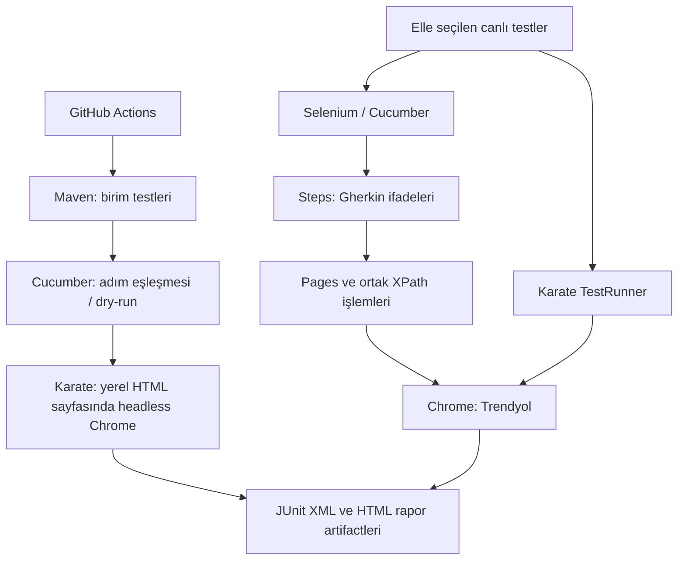

# Otomasyon mimarisi

Ana Maven projesi JUnit 4, Cucumber ve Selenium kullanır. Karate ayrı POM ile JUnit 5 çalıştırır. Bağımlılıklar ve test keşfi birbirinden ayrıdır.

Selenium: e-commerce.feature → EcommerceIT → steps → pages/TestContext → Chrome. XPathSteps doğrudan Gherkin'den XPath alabilir. Hooks tarayıcı oturumunu kapatır.

Karate: TestRunner → navigation.feature → common/locators.json + karate-config.js → Chrome. Java Step Definition gerekmez. SetupRunner, Trendyol'a bağlanmadan fixture.html üzerinde input/click/assertion ve screenshot işlemlerini doğrular.

Standart CI, canlı site erişiminin başarılı olduğunu iddia etmez. Cucumber dry-run yalnızca adımların Java'ya eşleşmesini doğrular. Canlı testler workflow_dispatch seçeneğiyle ayrıca çalıştırılabilir. Sayfa değişiklikleri veya güvenlik engelleri test başarısızlığı olarak korunur.

Güncel kaynakta SQL logger veya SQL sonuç tablosuna bağlanan plugin bulunmuyor. Önceki sürümlerdeki SQL doğrulamaları bu sürümün özelliği olarak gösterilmez. Raporlar Maven/Cucumber/Karate tarafından üretilir ve CI artifact'i olarak saklanır.
