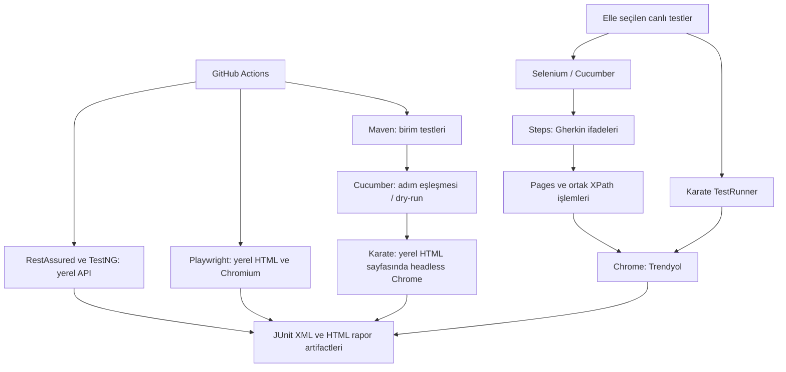

# Otomasyon mimarisi

Ana Maven projesi JUnit 4, Cucumber ve Selenium kullanır. Karate ayrı POM ile JUnit 5 çalıştırır. Bağımlılıklar ve test keşfi birbirinden ayrıdır. api-tests ve playwright-ui da bağımsız Maven projeleridir.

Selenium: e-commerce.feature → EcommerceIT → steps → pages/TestContext → Chrome. XPathSteps doğrudan Gherkin'den XPath alabilir. Hooks, ScenarioCleanup ile başarısızlıkta PNG'yi Cucumber raporuna ekler ve tarayıcı oturumunu kapatır; finally ile ThreadLocal temizlenir. Screenshot/attachment hatası asıl senaryo hatasını değiştirmez.

Karate: TestRunner → navigation.feature → common/locators.json + karate-config.js → Chrome. Java Step Definition gerekmez. SetupRunner, Trendyol'a bağlanmadan fixture.html üzerinde input/click/assertion ve screenshot işlemlerini doğrular.

Standart CI, canlı site erişiminin başarılı olduğunu iddia etmez. Cucumber dry-run yalnızca adımların Java'ya eşleşmesini doğrular. Canlı testler workflow_dispatch seçeneğiyle ayrıca çalıştırılabilir. Sayfa değişiklikleri veya güvenlik engelleri test başarısızlığı olarak korunur.

Güncel kaynakta SQL logger veya SQL sonuç tablosuna bağlanan plugin bulunmuyor. Önceki sürümlerdeki SQL doğrulamaları bu sürümün özelliği olarak gösterilmez. Raporlar Maven/Cucumber/Karate tarafından üretilir ve CI artifact'i olarak saklanır.

Playwright: SearchSmokeTest, yerel HTML üzerinde XPath ile input/click/assertion işlemlerini doğrular. CI, Chromium headless shell kurulumunu yapar ve playwright-test-reports artifact'ini toplar. HomePageIT açıkça -Dtest=HomePageIT ile seçilen canlı TC-001 testidir. HTTP yanıtı başarısızsa assertion hatası verir; navigation.txt, HTML ve PNG kaydını dener. Kanıt toplama hatası asıl hataya suppressed exception olarak eklenir.

API: ProductApiTest → her test için LocalApiServer → RestAssured HTTP istekleri → TestNG assertion ve raporları. InvalidProductData negatif veri setlerini sağlar. testng.xml regresyonda 10, testng-smoke.xml smoke paketinde 3 çalıştırma seçer. CI api-test-reports artifact'ini toplar.

Pages yayını verify, api-tests ve playwright-tests job'larının başarısını bekler. [Doğrulanmış CI kapsamı](evidence/ci-2026-11-06.md). [Playwright canlı HTTP 403 kaydı](evidence/playwright-tc001.md).