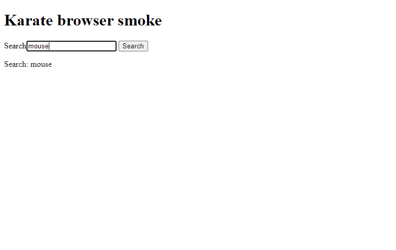

# Test kanıtları — 17 Ekim 2026

Bu kayıt yerel Windows ortamında gerçek komutlarla oluşturuldu. Uzak GitHub Actions başarısı veya canlı Trendyol sonucu olarak sunulmaz.

| Kontrol | Sonuç | Kanıtladığı kapsam |
|---|---|---|
| SelectedProductTest | 2 geçti | Ürün kimliği / ad yardımcıları |
| TurkishPriceTest | 3 geçti | Türkçe fiyat ayrıştırma |
| EcommerceIT dry-run | 3 adım eşleşmesi geçti | Gherkin–Java eşleşmesi; tarayıcı işlemi çalışmaz |
| SetupRunner | 1 geçti | Gerçek headless Chrome: yerel HTML'de metin yazma, tıklama, sonuç doğrulama |

[Makine tarafından okunabilir sonuç özeti](evidence/local-results.json), Surefire XML dosyalarından çıkarılmıştır. sourceCommit doğrulanan kaynak tabanını gösterir; kanıt dokümanlarını içeren sonraki commit ile karıştırılmamalıdır.

```powershell
mvn clean test '-Dtest=*Test,EcommerceIT' '-Dcucumber.execution.dry-run=true'
mvn -f karate-ui/pom.xml test '-Dtest=SetupRunner' '-Dheadless=true'
```

## Tarayıcı ekran görüntüsü

Bu, yerel fixture testinin `screenshot()` adımından alınmıştır; Trendyol arama sonucu değildir.



## Güncel CI sonuçlarını görme

[Actions sayfasından](https://github.com/yusufkg/Trendyol-Test-Automation/actions/workflows/ci.yml) ilgili commit koşusunu açın. `test-reports` artifact'ini indirip Surefire XML, Cucumber dry-run HTML ve Karate HTML raporlarını inceleyin. Canlı senaryolar yalnızca elle seçilen koşuda çalışır. Raporların kapsamı job özetinde ayrıca belirtilir.
